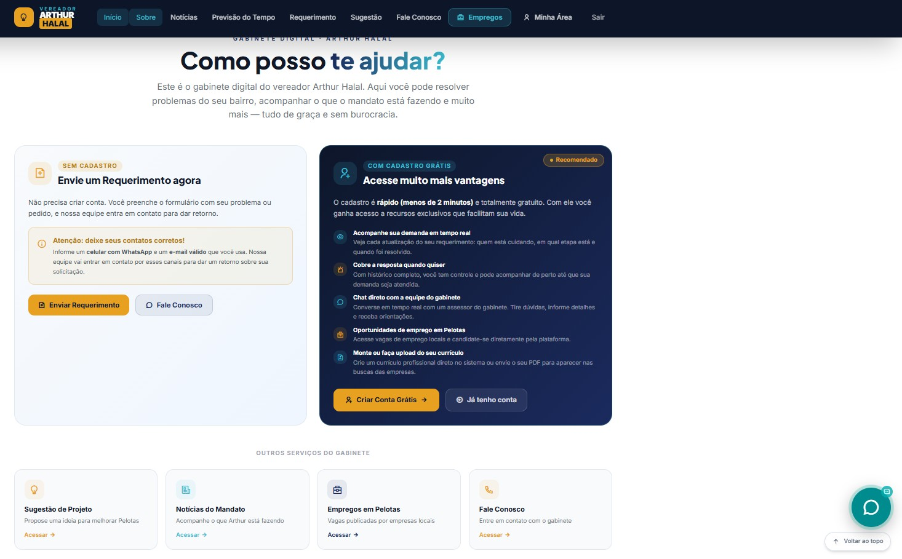
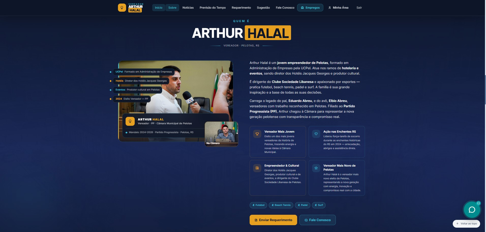
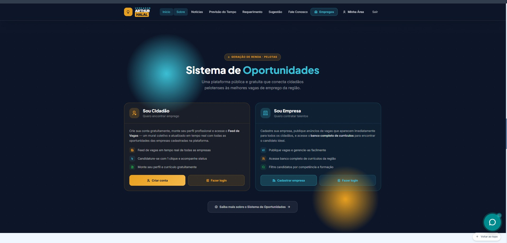
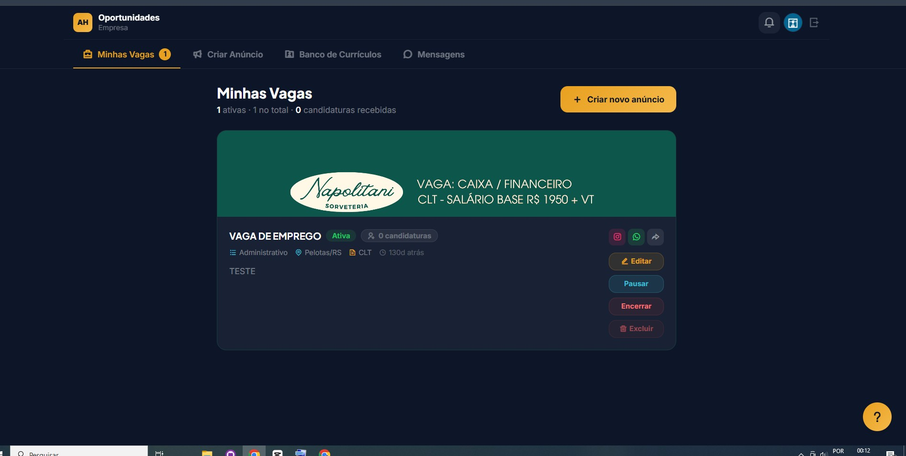
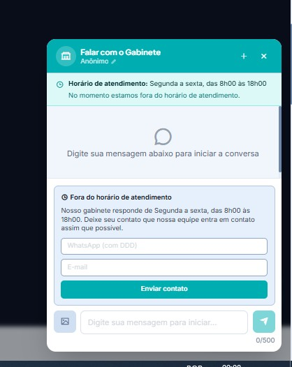
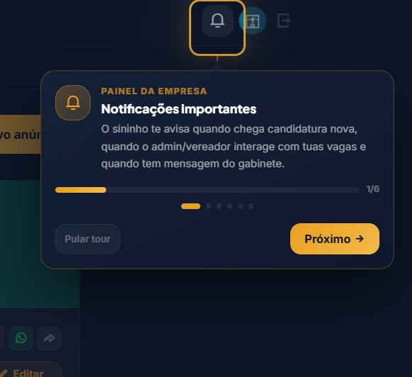
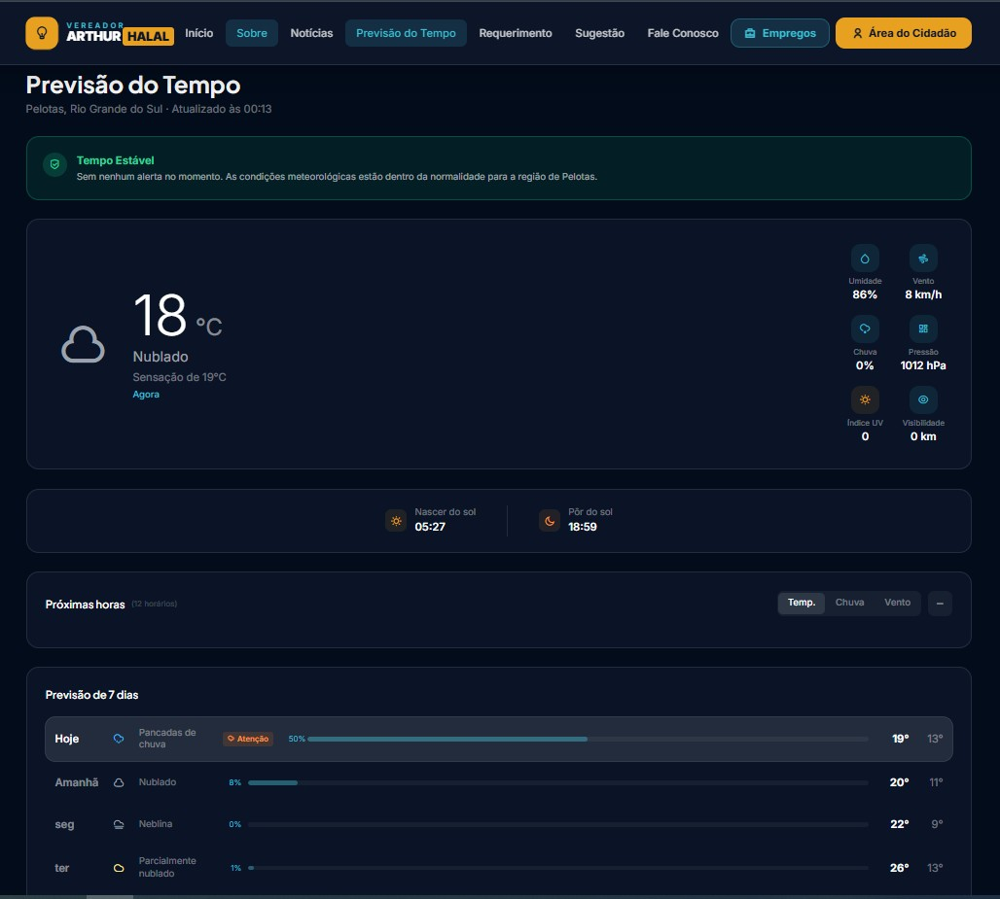

# Portal do Vereador — Gabinete Digital

Desenvolvi este portal para aproximar o gabinete da população e reunir, em um só lugar, comunicação, participação cidadã, acompanhamento de demandas e oportunidades de emprego. O projeto contempla uma área pública e ambientes próprios para cidadão, empresa, assessor e vereador.

[Acessar a demonstração](https://portal-do-vereador-vercel.vercel.app/)


## O que o projeto resolve

Organizei o atendimento para que o cidadão possa entrar em contato com o gabinete, registrar uma solicitação e acompanhar seu andamento. A equipe acompanha as demandas, enquanto o vereador tem uma visão do trabalho realizado e das oportunidades oferecidas à população.

Também desenvolvi uma central de oportunidades: empresas parceiras divulgam vagas e cidadãos cadastrados podem se candidatar e acompanhar suas candidaturas.

## Experiências por perfil

| Perfil | Recursos |
| --- | --- |
| Visitante | Apresentação do mandato, notícias, informações públicas, previsão do tempo e contato com o gabinete sem login. |
| Cidadão | Cadastro e login, envio e acompanhamento de demandas, mensagens, currículo e candidaturas a vagas. |
| Empresa | Publicação e gestão de vagas, acompanhamento de candidaturas e comunicação com o gabinete. |
| Assessor | Gestão de demandas, organização por status e atendimento aos cidadãos por chat. |
| Vereador | Visão geral das demandas, acompanhamento da equipe, indicadores e oportunidades de emprego. |

## Área pública

Criei uma entrada com apresentação do vereador, informações do mandato e caminhos diretos para requerimentos, sugestões, notícias e contato. O visitante pode conhecer o trabalho do gabinete e iniciar um atendimento sem criar uma conta.



<details>
<summary>Ver apresentação e informações do mandato</summary>




</details>

## Central de oportunidades

Conectei a participação das empresas à área do cidadão: as empresas publicam as oportunidades e os cidadãos autenticados podem se candidatar. O gabinete acompanha esse fluxo junto às demais atividades da plataforma.




## Atendimento e demandas

Implementei canais de contato público e atendimento autenticado. As demandas são organizadas por status, com acompanhamento pela equipe e pelo vereador. As capturas originais dos painéis internos contêm dados individuais e não estão incluídas nesta galeria.



## Orientação durante o uso

Adicionei tours específicos para os perfis, com explicações sobre botões, notificações e tarefas de cada área. A proposta é facilitar o primeiro acesso e tornar os recursos mais fáceis de descobrir.



## Previsão do tempo

Incluí uma página de previsão do tempo e informações climáticas integradas à navegação do portal.



## Tecnologias presentes no código

- React 19 e TypeScript.
- Vite 8 e Tailwind CSS.
- React Router para navegação.
- Supabase para autenticação, dados e recursos em tempo real.
- Supabase Edge Functions para operações no servidor.
- Recharts, jsPDF e PDF.js nos recursos de gráficos e documentos.

## Executar localmente

Pré-requisito: Node.js compatível com o Vite 8 (20.19+ ou 22.12+).

```bash
npm ci
cp .env.example .env
npm run dev
```

Configure no `.env` a URL do seu projeto Supabase e a chave pública `anon`. Nunca coloque uma chave `service_role` em variáveis `VITE_`, pois elas são expostas ao navegador.

O frontend depende de um projeto Supabase com banco, políticas de acesso, autenticação, armazenamento e funções compatíveis. O ZIP recuperado contém funções em `supabase/functions`; apenas configurar as duas variáveis não recria automaticamente o backend existente.

## Compilação e publicação

```bash
npm run build
npm run preview
```

O resultado da compilação fica em `out/`. A configuração `vercel.json` define essa pasta e o redirecionamento das rotas para `index.html`.

## Privacidade e escopo desta versão

Preparei esta cópia para apresentação do projeto. O arquivo `.env` original foi excluído e as senhas fixas de contas de teste foram substituídas por marcadores. Rotinas de criação ou redefinição de usuários precisam ser configuradas e revisadas antes de uso; os marcadores não são credenciais de acesso.

Selecionei nove das vinte capturas originais para esta galeria, evitando telas com dados individuais e credenciais. As capturas documentam a interface; não substituem testes atuais das integrações e permissões do sistema.
